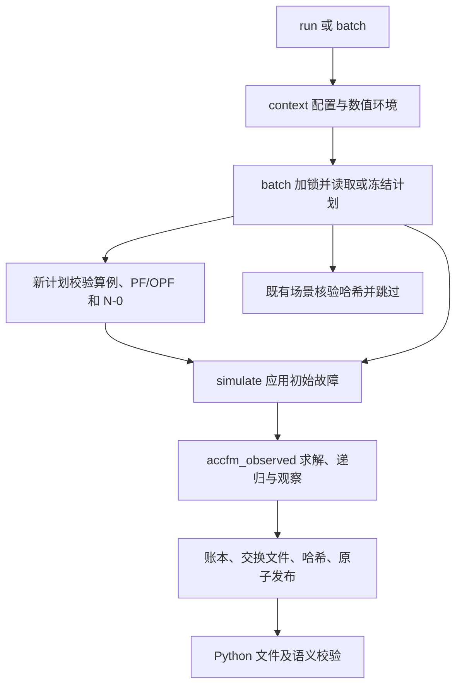

# 架构

`run` 构建一个场景，复用 `batch` 的计划和事务路径，再加载已发布的记录。`prepare` 只执行工况验收。`context` 规范化配置、环境和算例摘要。`prepare_case` 在 MATPOWER 求解前调用 `validate_case`，随后验收限值和 AC 平衡。`prepare_validated` 调用原版 AC-CFM 做 N-0。

`simulate` 实施外部母线事故，再把原生支路和机组故障交给观察版。分岛用原版 MATPOWER custom 字段保留原行号。 `core/build_observed.py` 在固定上游源码的调用、矩阵写入和图变更处插入读取点。原保护逻辑和求解调用顺序保持原版。回调采集失败或上游宽泛 PF catch 捕获到调用边界之外的程序异常时，`simulate` 抛出错误并停止发布该场景。

`batch` 管理 writer 锁、冻结计划、场景暂存、完整性和原子发布。`write_exchange` 负责面向 Python 的 JSONL、MAT 与 CSV。Python 同时检查文件 SHA-256、导出之间的一致性以及依据观测重建的矩阵与图。

维护保护观察点时修改 `core/build_observed.py`，再执行生成器检查和原版等价回归。增加实验参数时，从 `config`、`context` 和 `model_settings` 的相应层接入冻结计划。演进导出字段时同步维护 `write_exchange`、`python/read_run.py`、观测修订号与破坏性测试。上游源码清单保留在 `core/vendor-lock.json`。
